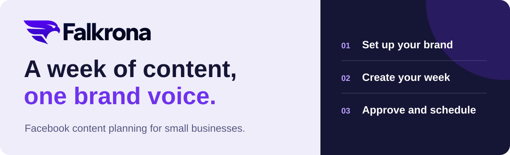
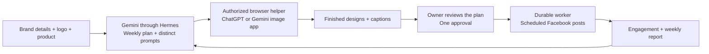

# Falkrona · Your Brand’s Pilot

<p align="center">
  
</p>

<p align="center">
  <strong>Plan, design, and schedule Facebook posts for your small business.</strong><br />
  Save your brand brief and product photos, create a week of distinct designs, and approve the whole plan in one place.
</p>

<p align="center">
  <a href="#what-falkrona-does">Features</a> ·
  <a href="#how-it-works">How it works</a> ·
  <a href="docs/SETUP.md">Complete setup</a> ·
  <a href="docs/DEPLOYMENT.md">Deploy online</a> ·
  <a href="docs/QUICKSTART.md">First campaign</a> ·
  <a href="docs/SETUP.md#troubleshooting">Troubleshooting</a>
</p>

<p align="center">
  
  
  
  
  
</p>

---

## Why Falkrona

Small businesses already use Gemini and GPT to create social media ads. Without clear design principles or a consistent brand identity, those ads can look cheap or disconnected from one post to the next.

Falkrona grew out of a graphic designer’s experience with that problem. It gives each campaign a shared palette, typography, logo treatment, and CTA style while developing a different creative idea for each post. The owner provides the brand details, reviews the finished work, and approves the schedule through one simple interface.

## What Falkrona does

| Capability | The owner experience |
| --- | --- |
| **Brand onboarding** | A short brand survey, required transparent logo, and optional design reference. |
| **Organized assets** | Product photos, logos, design references, and generated artwork have distinct roles. |
| **Weekly planning** | Hermes uses Gemini to draft and review a plan from your brand brief, campaign goal, and design language. |
| **Complete ad generation** | Hermes prepares a distinct creative brief for each post. The browser helper sends it to the selected image app and returns the artwork to Falkrona. |
| **Consistency with variety** | Shared palette, typography, logo treatment, and CTA style/position; different concepts and compositions across posts. |
| **Simple controls** | Arabic or English designs, delete an unwanted post/plan, regenerate a design with another idea, and change its posting date. |
| **One plan approval** | Review designs, captions, and Cairo posting times, then approve the whole plan to schedule Facebook delivery. |
| **Weekly results** | Engagement collection and weekly reports help inform the next plan when the connected platform grants access. |

### Current scope

| Integration | Status |
| --- | --- |
| Gemini API planning through Hermes | Available for weekly plans and individual design prompts. |
| ChatGPT website image generation | Automatic attachment, submission, and image return through Browser Helper **0.1.7**. |
| Gemini website image generation | Adapter included; live account validation is pending. |
| Facebook Page connection and scheduled publishing | Available with a configured Meta app, Page permissions, and running workers. |
| Instagram | Planned. Publishing is currently unavailable. |

Browser image generation depends on a signed-in browser and the image service’s current controls and account limits. See [image setup and recovery](docs/BROWSER_IMAGE_WORKFLOW.md).

## How it works



Falkrona checks the browser connection before drafting. Hermes uses Gemini to draft the campaign and review its copy and design direction. Falkrona validates the responses and saves progress. The browser helper sends the brief and assets to the connected image app and returns the artwork. A separate delivery worker publishes approved Facebook posts on schedule.

A product photo supplies **product identity**, such as the bottle, packaging, and label. Its original background, props, and composition are explicitly discarded. Only the optional reference supplies style inspiration. Generating designs does not authorize publication.

## Start here

The setup guide targets **Windows + PowerShell**. It covers dependencies, the database, Gemini and Hermes, account creation, the browser helper, and Facebook. Docker Compose runs PostgreSQL; the API, frontend, and workers run separately.

| You want to… | Follow this guide |
| --- | --- |
| Run Falkrona for the first time | [Complete setup, steps 1–7](docs/SETUP.md#1-prerequisites) |
| Try real planning and designs | [Gemini](docs/SETUP.md#4-enable-gemini-planning), then [browser helper](docs/SETUP.md#8-connect-the-browser-helper) |
| Connect Facebook and publish | [Meta setup, step 10](docs/SETUP.md#10-facebook-and-meta-setup) |
| Host Falkrona online | [Railway backend](docs/DEPLOYMENT.md#1-railway), then [Vercel frontend](docs/DEPLOYMENT.md#2-vercel) |
| Create your first campaign | [First campaign walkthrough](docs/QUICKSTART.md) |
| Fix a setup or generation issue | [Troubleshooting](docs/SETUP.md#troubleshooting) |

The first installation downloads application dependencies and a separate Hermes runtime. You will also need a Gemini API key and a signed-in image-app account for live generation.

### First-time local preparation

After installing [Git](https://git-scm.com/downloads), [Node 24](https://nodejs.org/en/download), [uv](https://docs.astral.sh/uv/getting-started/installation/), and [Docker Desktop](https://docs.docker.com/desktop/setup/install/windows-install/), open PowerShell:

```powershell
git clone https://github.com/dark0danger/Falkrona.git
cd Falkrona
uv python install 3.13
uv sync --locked --python 3.13
npm ci
.\.venv\Scripts\python.exe scripts/local_setup.py init
docker compose -f infra/postgres/compose.yaml up -d --wait postgres
powershell -ExecutionPolicy Bypass -File scripts/migrate.ps1
```

The setup utility creates `.env` with unique security values and cookies configured for local HTTP. It refuses to replace an existing file. The initial mode is `offline_test`, with external model calls and publishing disabled.

For the actual Gemini workflow, set the following values in your local `.env`. Replace the placeholders with your own key and a supported model ID. Get a key from [Google AI Studio](https://aistudio.google.com/apikey), check [model availability](https://ai.google.dev/gemini-api/docs/models) and [pricing/free-tier eligibility](https://ai.google.dev/gemini-api/docs/pricing), then prepare Hermes:

```dotenv
BRANDPILOT_EXECUTION_MODE=gemini_free
BRANDPILOT_MODEL_PROVIDER=gemini
BRANDPILOT_GEMINI_MODEL=YOUR_SUPPORTED_GEMINI_MODEL_ID
GEMINI_API_KEY=YOUR_GEMINI_API_KEY
BRANDPILOT_OPENAI_PAID_ENABLED=false
BRANDPILOT_IMAGE_API_ENABLED=false
```

```powershell
powershell -ExecutionPolicy Bypass -File scripts/prepare_hermes.ps1
.\.venv\Scripts\python.exe scripts/local_setup.py hermes
```

`gemini_free` selects Falkrona’s free-mode policy; it cannot guarantee that your Google project is unbilled. Use an eligible free-tier project/model and public brand information. A ChatGPT or Gemini website subscription does not supply a Gemini API key. An OpenAI API key is not needed for the browser-based ChatGPT image path.

### Start and create your account

Run the API and frontend in **separate PowerShell terminals**, both from the repository root:

```powershell
# Terminal 1 — API
powershell -ExecutionPolicy Bypass -File scripts/run_api.ps1
```

```powershell
# Terminal 2 — frontend
npm run dev --workspace @falkrona/web
```

Open [Falkrona locally](http://127.0.0.1:5173). Expand **First-time workspace setup**, choose **Set up the owner**, enter your account details and workspace name, and use `BRANDPILOT_OWNER_SETUP_TOKEN` from your own `.env` as the local setup token. After account creation:

```powershell
# Terminal 3 — select the new workspace, then start its worker
.\.venv\Scripts\python.exe scripts/local_setup.py workspace
powershell -ExecutionPolicy Bypass -File scripts/run_worker.ps1
```

The workspace utility selects the sole workspace in a fresh database; it refuses to guess if several exist. For scheduled publishing, also run a dedicated delivery worker in a fourth terminal:

```powershell
powershell -ExecutionPolicy Bypass -File scripts/run_worker.ps1 --publishing-only
```

Next, [install and connect the browser helper](docs/SETUP.md#8-connect-the-browser-helper). Complete Branding, upload a product photo, and draft a plan. Add [Facebook publishing access](docs/SETUP.md#10-facebook-and-meta-setup) when ready to test delivery.

## The owner workflow

1. **Branding:** answer the short survey, upload a transparent logo, optionally add a design reference, and save.
2. **Products:** upload product identity photos and enter truthful product details.
3. **Content plan:** choose a future week, product photo, Arabic or English, and consent to sharing the brand inputs. Click **Create my week**.
4. **Generate:** Hermes drafts and reviews the plan, headlines, captions, and image prompts using Gemini, then runs the connected image app. Finished posts appear in the plan. Saved interrupted runs offer **Continue creating designs**.
5. **Review:** inspect the artwork and captions. Regenerate, delete, or change future posting times before approval.
6. **Approve plan & schedule:** approve the whole plan for the selected Facebook Page. Workers publish the approved posts at their Cairo times.
7. **Results:** view engagement and weekly reports from the connected Page. New posts may need time to accumulate data.

Keep the image-app browser open during generation. Keep the API, database, and workers running while scheduled jobs need to execute.

## Planned improvements

- Direct OpenAI or Gemini image-generation API integration, so artwork returns to Falkrona without a browser helper.
- Instagram connection and publishing after integration testing.

## Architecture

| Component | Responsibility |
| --- | --- |
| `apps/web` | React 19 + TypeScript owner interface; Vite proxies `/api` and `/health`. |
| `apps/api` | FastAPI authentication, workspace authorization, assets, plans, image handoff, and scheduling APIs. |
| `apps/worker` | Restartable workspace-scoped job execution, planning, engagement, reports, and publishing. |
| `packages/brandpilot_core` | Domain services, provider policy, durable jobs, storage, and PostgreSQL row-level security. |
| `packages/hermes_plugin` | Falkrona tool contracts for the pinned Hermes integration and offline probes. |
| `apps/browser-helper` | Chrome/Edge Manifest V3 extension for the authorized image-app handoff. |
| `infra/hermes` | Pinned runtime metadata and the social-media graphic-design skill. |
| `migrations` | Alembic database migrations. |

The application uses Python **3.13**, Node **24** / npm **11**, and PostgreSQL **17**. Hermes has its own separately managed runtime; do not install it into Falkrona’s `.venv`. Its exact source revision is recorded in [`infra/hermes/pin.json`](infra/hermes/pin.json).

## Tests

Tests cover the API, owner interface, browser helper, and publishing workflow. The default suite runs without live provider credentials.

```powershell
# Backend tests
.\.venv\Scripts\python.exe -m pytest

# Frontend tests and build
npm test
npm run build

# Browser helper tests
node --test apps/browser-helper/background.test.cjs apps/browser-helper/provider.test.cjs apps/browser-helper/provider-dom.test.cjs
```

See [development checks](docs/SETUP.md#verification-and-development) for PostgreSQL integration tests.

## Documentation

| Guide | Contents |
| --- | --- |
| [Complete setup](docs/SETUP.md) | Install everything, configure accounts, run services, connect Meta, and troubleshoot. |
| [Railway and Vercel deployment](docs/DEPLOYMENT.md) | Host the API, workers, database, assets and frontend. |
| [First campaign](docs/QUICKSTART.md) | Set up a brand, create designs, and approve a weekly plan. |
| [Gemini planning](docs/GEMINI_CREATIVE_SETUP.md) | Provider configuration, asset roles, and planning boundaries. |
| [Browser image workflow](docs/BROWSER_IMAGE_WORKFLOW.md) | Consent, handoff, image import, adapter limits, and recovery. |
| [Browser helper](apps/browser-helper/README.md) | Installation, updating, connection, and account handling. |
| [Social checklist](docs/SOCIAL_APP_CHECKLIST.md) | Facebook permission and callback details; Instagram scope. |
| [Security operations](docs/SECURITY.md) | Secrets, credential encryption, rotation, and recovery. |
| [Dependency licenses](docs/DEPENDENCY_LICENSES.md) | Third-party package metadata. |

## License

Falkrona currently declares a **proprietary** license in `pyproject.toml`. Public source visibility does not grant an open-source license. Hermes and other dependencies retain their respective licenses; see the [dependency inventory](docs/DEPENDENCY_LICENSES.md).

---

<p align="center"><strong>Falkrona — Your Brand’s Pilot</strong><br /><sub>A consistent creative process for small businesses.</sub></p>
